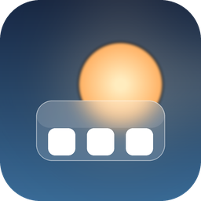
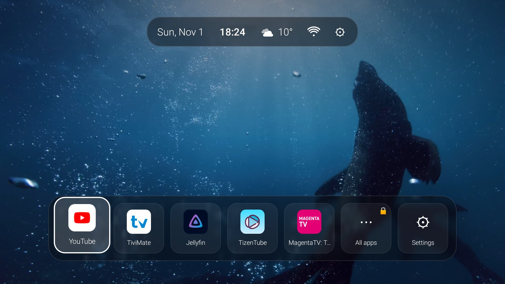
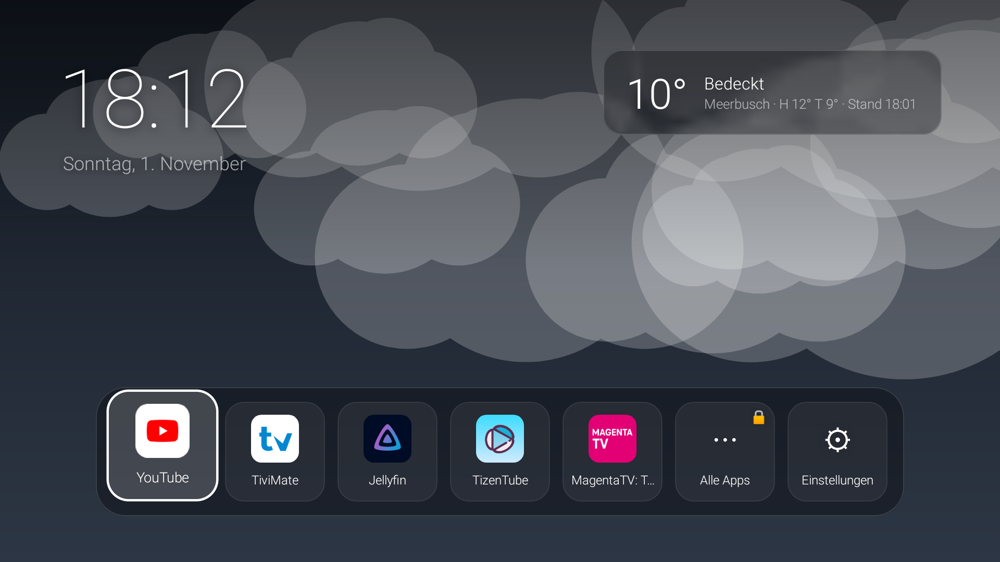
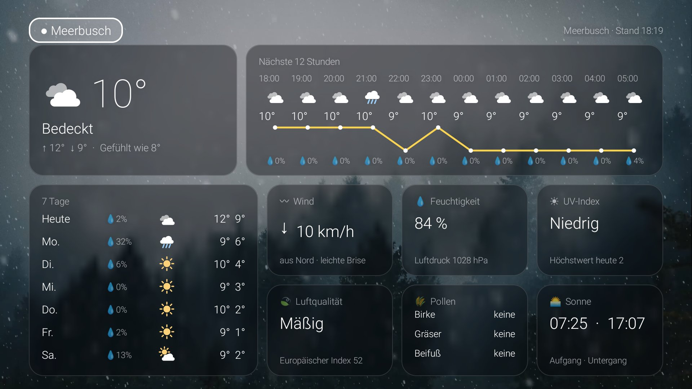
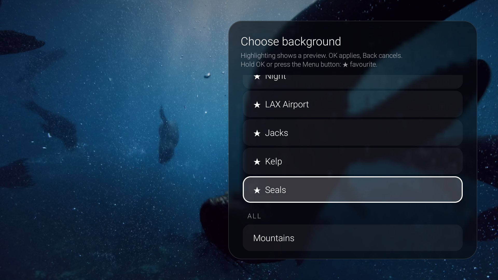
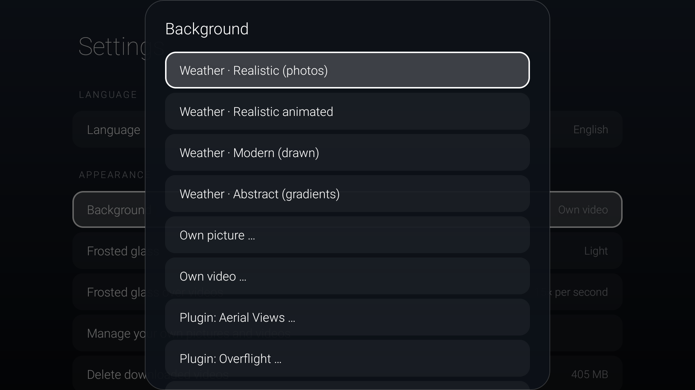
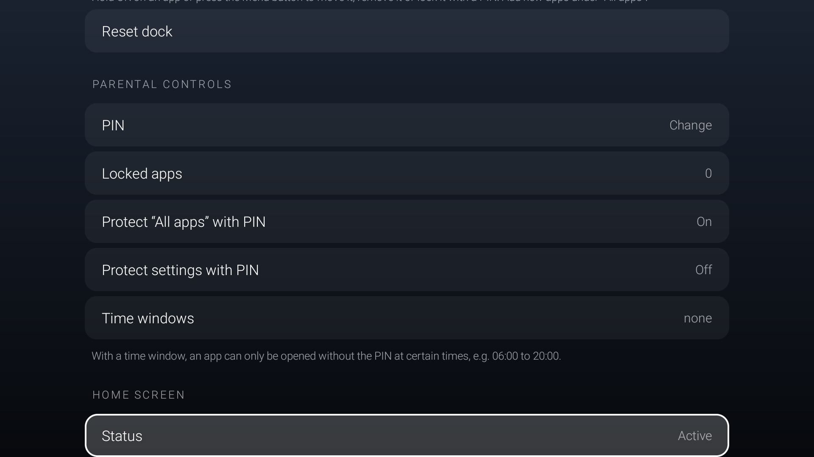
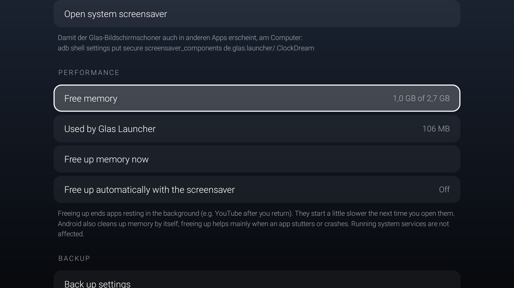
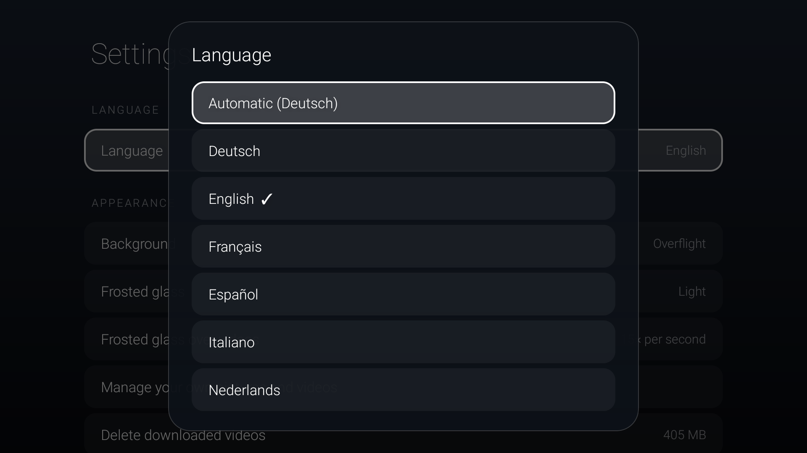

# Glas Launcher

Werbefreie Startseite für den TCL Google TV: Statusleiste mit Wetter, WLAN, Datum und Uhrzeit, wechselnde Hintergründe
und Apps in einem Dock aus dunklem Milchglas.

Aktuelle Versionen: **Glas Launcher 2.38**, **Glas Natur-Videos 1.2**, **Glas Smart 2.8** (Handy-App für Smart-Life-Geräte).



## Bilder

| | |
|---|---|
|  |  |
| Große Uhr mit Wetterkarte und gezeichnetem Wetter-Hintergrund | Ausführliches Wetter: 12 Stunden, 7 Tage, Wind, UV, Luftqualität, Pollen |
|  |  |
| Hintergrund mit Live-Vorschau und Favoriten (★) wählen | Wetter-Hintergründe, eigene Bilder und Videos, Plugins |
|  |  |
| Kindersicherung mit PIN und Zeitfenstern | Arbeitsspeicher anzeigen und freigeben |
|  | |
| Sechs Sprachen | |

## Funktionen

- **Statusleiste oben mittig:** Datum, Uhrzeit, Wettersymbol mit Temperatur, WLAN-Signalstärke und Zahnrad zu den
  Fernseher-Einstellungen. Auf Wunsch eingeklappt, dann nur die Uhrzeit oben rechts. Alternativ große Uhr mit Wetterkarte.
- **Dock:** Apps hinzufügen, entfernen und verschieben. Alle Symbole als einheitlich abgerundete Quadrate.
- **Kindersicherung:** Apps, „Alle Apps“ und die Einstellungen mit 4-stelligem PIN sperren. Zeitfenster pro App
  (z. B. 06:00 bis 20:00 Uhr), außerhalb nur mit PIN; solche Apps tragen ⏰.
- **Unwetterwarnungen:** amtliche DWD-Warnungen (über Bright Sky) in Deutschland, sonst aus der Open-Meteo-Vorhersage
  abgeleitet (Gewitter, Sturmböen, Glätte, Starkregen, Schneefall). Der gelbe Hinweis oben erscheint auch bei
  eingeklappter Statusleiste; anklicken zeigt die Einzelheiten.
- **Leistung:** freier Arbeitsspeicher und Verbrauch des Launchers, Speicher auf Knopfdruck oder automatisch beim
  Bildschirmschoner freigeben.
- **Sichern:** alle Einstellungen in eine Datei sichern und wiederherstellen, auch auf einem anderen Fernseher.
- **Updates:** sucht täglich in einem GitHub-Projekt nach einer neuen Version und installiert sie.
- **Sprachen:** Deutsch, English, Français, Español, Italiano, Nederlands. Automatisch wie der Fernseher oder fest gewählt.
- **Hintergründe:** Wetter realistisch (Fotos), realistisch animiert (gezeichnete Wolken, Regen, Schnee, Blitze),
  modern (gezeichnet) oder abstrakt (Farbverläufe), eigenes Bild,
  eigene Videos (einzeln oder abwechselnd, mit Schnellauswahl und Favoriten), Erweiterungen wie „Glas Natur-Videos“ und Projectivy-Plugins.
- **Hintergrund-Leiste:** weiterschalten und mit Live-Vorschau auswählen.
- **Milchglas:** hell, mittel oder dunkel; über Videos einstellbar, wie oft es das Bild übernimmt (Standbild bis 15× pro Sekunde).
- **Bildschirmschoner:** große Uhr mit Datum und Wetter, wandert gegen Einbrennen.
- **Wetter:** Open-Meteo, beliebige Orte, hohe Schleierwolken werden herausgerechnet.
- **Startbildschirm:** ersetzt die Google-TV-Oberfläche, auch nach einem Neustart.

## Bedienung auf dem Fernseher

| Was | Wie |
|---|---|
| App verschieben, entfernen, sperren | Im Dock auf der App **OK gedrückt halten** oder **Menü-Taste** |
| App zum Dock hinzufügen | *Alle Apps* → App OK gedrückt halten → „Zum Dock hinzufügen“ |
| „Alle Apps“ sperren | Auf „Alle Apps“ OK gedrückt halten → „Mit PIN sperren“ |
| Hintergrund weiterschalten | Im Dock **nach oben** → ◀ / ▶ |
| Hintergrund mit Vorschau wählen | Im Dock nach oben → auf den Titel klicken → Liste durchblättern, **OK** übernimmt, **Zurück** bricht ab |
| Favorit markieren | In der Hintergrund-Liste auf einem Eintrag **OK gedrückt halten** oder **Menü-Taste** → ★ |
| Nur Favoriten zeigen | Hintergrund-Liste → „Nur Favoriten wechseln“ |
| Statusleiste | Im Dock nach oben (bei aktiver Hintergrund-Leiste zweimal) |
| Ausführliches Wetter | Statusleiste → Wettersymbol, oder die Wetterkarte bei der großen Uhr |
| WLAN-Einstellungen | Statusleiste → WLAN-Symbol |
| Fernseher-Einstellungen | Statusleiste → ⚙ (mit PIN, wenn die Einstellungen geschützt sind) |
| Statusleiste ein- und ausklappen | Statusleiste → Uhrzeit anklicken; erneut auf die Uhrzeit oben rechts klicken |
| Einstellungen des Launchers | ⚙ **Einstellungen** im Dock |

Die Hintergrund-Leiste erscheint nur bei Hintergründen mit mehreren Videos oder Bildern. Sie blendet sich nach
5 Sekunden ohne Tastendruck oder beim Wechsel ins Dock wieder aus.

## Einstellungen

- **Sprache:** Automatisch (Sprache des Fernsehers, sonst Englisch) oder eine feste Sprache
- **Aussehen:** Hintergrund, Milchglas, *Oben anzeigen* (Statusleiste oder große Uhr mit Wetterkarte),
  eigene Bilder und Videos löschen, heruntergeladene Videos löschen
- **Wetter:** Orte suchen und hinzufügen, Hauptort festlegen (bestimmt den Hintergrund), Orte entfernen
- **Dock:** zurücksetzen auf YouTube, Netflix, MagentaTV und Jellyfin
- **Kindersicherung:** PIN festlegen, ändern oder entfernen, gesperrte Apps, „Alle Apps“ und Einstellungen schützen, Zeitfenster
- **Leistung:** Arbeitsspeicher frei/gesamt, Verbrauch des Launchers, jetzt freigeben, automatisch beim Bildschirmschoner freigeben.
  Freigeben beendet Apps, die im Hintergrund ruhen; Android räumt auch selbst auf.
- **Sichern:** Einstellungen sichern nach `Download/GlasLauncher-Einstellungen.json` und wiederherstellen. Für einen anderen
  Fernseher die Datei nach `/sdcard/Android/data/de.glas.launcher/files/` kopieren (z. B. mit Bugjaeger).
- **Updates:** installierte Version, „Neu in Version …“ mit früheren Versionen, Update-Quelle (`Name/Projekt` auf GitHub), jetzt nach Updates suchen
- **Startbildschirm:** Status, als Standard festlegen, Home-Taste umleiten
- **Bildschirmschoner:** Uhrzeit, Datum und Wetter einzeln ein- und ausschalten (alles aus zeigt nur den Hintergrund), Zeit bis zum Start im Launcher, jetzt anzeigen, System-Bildschirmschoner
- **Fernseher:** Fernseher-Einstellungen öffnen
- **Info:** installierte Versionen von Glas Launcher und Glas Natur-Videos

## Bauen

```
gradle assembleDebug
```

- Launcher: `app/build/outputs/apk/debug/GlasLauncher-<Version>.apk`, z. B. `GlasLauncher-2.38.apk`
- Erweiterung: `videos/build/outputs/apk/debug/GlasNaturVideos-<Version>.apk`
- Smart-Life-App fürs Handy: `smart/build/outputs/apk/debug/GlasSmart-<Version>.apk`

Die Versionsnummer steckt immer im Dateinamen. Die fertigen APKs liegen auch im Projektordner.

**Signaturschlüssel:** `keystore/glas-launcher.keystore` (Alias `androiddebugkey`, Passwort `android`). Alle Versionen
werden damit signiert, so lassen sich Updates von jedem Rechner aus über die alte Version installieren. Den Ordner
`keystore` nicht löschen. Da der Schlüssel öffentlich im Projekt liegt, ist er nur für den privaten Gebrauch gedacht.

**Updates über GitHub:** Ein Release mit dem Tag `v2.38` anlegen und `GlasLauncher-2.38.apk` anhängen. Ist in den
Einstellungen unter *Updates* die Quelle `Name/Projekt` eingetragen, meldet der Launcher die neue Version.

**Was neu ist:** Steht in `app/src/main/assets/changelog.json` (alle sechs Sprachen) und erscheint unter
*Einstellungen → Updates → Neu in Version …*. Der Text eines GitHub-Releases wird vor dem Installieren angezeigt.

**TCL-Fernseher:** Dort zeigt *Installieren unbekannter Apps* den Glas Launcher manchmal als „Zugelassen“, obwohl
Android die Erlaubnis nicht erteilt hat. Abhilfe einmalig per Bugjaeger-Shell bzw. `adb shell`:

```
appops set de.glas.launcher REQUEST_INSTALL_PACKAGES allow
```

## Installieren oder aktualisieren

Einmalig am Fernseher:

1. *Einstellungen → System → Info* → 7× auf *Android TV-Betriebssystem-Build* drücken.
2. *Einstellungen → System → Entwickleroptionen* → **USB-Debugging** einschalten.

Bei Updates bleiben Dock, PIN und Einstellungen erhalten.

**Vom Android-Handy mit Bugjaeger** (ohne Computer)

1. App **„Bugjaeger Mobile ADB“** aus dem Play Store installieren. Handy und Fernseher im selben WLAN.
2. Auf das **Stecker-Symbol** tippen, Adresse `192.168.178.173`, Port `5555`, verbinden.
   Am Fernseher „USB-Debugging zulassen?“ mit **Zulassen** bestätigen.
3. APK installieren: Reiter mit dem **Paket-Symbol** → *Installieren* → APK auswählen.
4. Befehle: Reiter **Shell**. Dort **ohne** das `adb shell` davor eingeben.

**Vom Computer**

```
adb connect 192.168.178.173
adb install -r GlasLauncher-2.38.apk
adb install -r GlasNaturVideos-1.2.apk
```

## Startbildschirm festlegen

Google TV bietet keine Auswahl für den Startbildschirm. Es gibt zwei Wege.

**A) Google-Oberfläche abschalten (empfohlen)**

Danach startet der Fernseher direkt im Glas Launcher, auch nach einem Neustart.

**Direkt im Launcher (ab 2.35):** *Einstellungen → Startbildschirm → Google-TV-Oberfläche* → Ausschalten bzw.
Einschalten. Der Launcher verbindet sich dafür mit dem Debugging-Zugang des Fernsehers selbst (127.0.0.1:5555, wie
Bugjaeger), mit der Bibliothek [dadb](https://github.com/mobile-dev-inc/dadb) (Apache-2.0). Voraussetzung: USB-Debugging
in den Entwickleroptionen ist an. Beim ersten Mal fragt der Fernseher „USB-Debugging zulassen?“ → „Immer zulassen“ und
„Zulassen“ wählen.

**Von Hand:** In der Bugjaeger-Shell (ohne `adb shell`) oder am Computer:

```
adb shell pm disable-user --user 0 com.google.android.apps.tv.launcherx
adb shell pm disable-user --user 0 com.google.android.tungsten.setupwraith
```

Erfolgreich, wenn jeweils `new state: disabled-user` erscheint. Nach großen System-Updates gegebenenfalls wiederholen.

Rückgängig:

```
adb shell pm enable com.google.android.apps.tv.launcherx
adb shell pm enable com.google.android.tungsten.setupwraith
```

**B) Home-Taste umleiten (ohne adb)**

*Einstellungen → System → Bedienungshilfen* → „Glas Launcher: Home-Taste umleiten“ einschalten.
Erscheint „Eingeschränkte Einstellung“: *Einstellungen → Apps → Glas Launcher* → ⋮ → „Eingeschränkte Einstellungen zulassen“,
danach erneut einschalten. Nach einem Neustart öffnet sich der Glas Launcher von selbst, vorher ist kurz die
Google-Oberfläche zu sehen.

Per adb geht es auch:

```
adb shell settings put secure enabled_accessibility_services de.glas.launcher/.HomeRedirectService
adb shell settings put secure accessibility_enabled 1
```

## Fire TV Stick

Läuft ab Fire OS 6 (Android 7.1), also auch auf dem ersten Fire TV Stick 4K. Einschränkungen:

- **Startbildschirm:** Amazon erlaubt keinen anderen Startbildschirm, und das Abschalten der Amazon-Oberfläche per adb
  ist auf neueren Fire-OS-Versionen gesperrt. Die Home-Taste-Umleitung (*Einstellungen → Bedienungshilfen*) erkennt
  die Amazon-Oberfläche (`com.amazon.tv.launcher`); ob Amazon das zulässt, hängt von der Fire-OS-Version ab.
- Manche Amazon-eigenen Apps erscheinen nicht unter „Alle Apps“.
- Installation: *Einstellungen → Mein Fire TV → Info* → 7× auf den Gerätenamen → *Entwickleroptionen* → **ADB-Debugging**
  einschalten, dann mit Bugjaeger verbinden (IP unter *Mein Fire TV → Info → Netzwerk*).

## Bildschirmschoner systemweit

Damit der Glas-Bildschirmschoner auch in anderen Apps erscheint:

```
adb shell settings put secure screensaver_components de.glas.launcher/.ClockDream
```

## Eigene Bilder und Videos

Dateien auf den Fernseher kopieren, dann in den Einstellungen unter *Hintergrund* auswählen:

```
adb push urlaub.jpg /sdcard/Pictures/
adb push aquarium.mp4 /sdcard/Movies/
```

**Mehrere eigene Videos:** Unter *Hintergrund → Eigenes Video …* gibt es „Alle eigenen Videos abwechselnd“. Wie bei
den Plugins schaltest du dann im Dock **nach oben** mit ◀ / ▶ weiter oder wählst mit Live-Vorschau. Videos lassen sich
dort mit **OK gedrückt halten** oder der **Menü-Taste** als Favorit (★) markieren, und „Nur Favoriten wechseln“ spielt
nur diese ab. Auch bei einem einzelnen gewählten Video stehen die anderen in der Schnellauswahl bereit.

**Videoformat:** Am flüssigsten laufen Videos in 1080p mit 25 oder 30 Bildern pro Sekunde, ohne HDR, als MP4 (H.264
oder HEVC). Bei 4K, 60 Bildern pro Sekunde oder HDR zeigt der Launcher beim Auswählen einen Hinweis.
Beim Öffnen einer App gibt der Launcher den Video-Decoder sofort frei (viele Fernseher haben nur einen für 4K)
und setzt das Video bei der Rückkehr an derselben Stelle fort.

**Löschen:** *Einstellungen → Aussehen → Eigene Bilder und Videos verwalten* → Datei wählen → „Löschen“.
Ab Android 10 fragt das System bei Dateien, die nicht vom Launcher stammen (z. B. per `adb push` kopiert), zusätzlich
selbst nach. Ist die gelöschte Datei der Hintergrund, zeigt der Launcher wieder das Wetter.
*Heruntergeladene Videos löschen* leert den Zwischenspeicher der Erweiterungen; eigene Dateien bleiben erhalten.

Eigene **Wetterfotos** ersetzen die eingebauten, wenn sie in `/sdcard/Pictures/GlasLauncher/` liegen und so heißen:
`clear_day`, `partly_day`, `overcast_day`, `fog_day`, `rain_day`, `snow_day`, `storm_day`, Nacht z. B. `clear_night`,
`partly_night`, `rain_night` (jeweils `.jpg`). Fehlt ein Nachtfoto, wird das Tagfoto abgedunkelt.

## Wetter

**Wetter-Ansicht:** jetzt, nächste 12 Stunden mit Temperaturverlauf, 7 Tage, Wind, Luftfeuchtigkeit und Luftdruck,
UV-Index, Luftqualität (europäischer Index), Pollen (Birke, Gräser, Beifuß) sowie Sonnenauf- und -untergang.
Oben lässt sich zwischen den Orten umschalten. Luftqualität und Pollen kommen von der Open-Meteo-Air-Quality-API.

- Quelle: [Open-Meteo](https://open-meteo.com), kostenlos und ohne Konto, Ortssuche über die Open-Meteo-Geocoding-API.
- Aktualisierung höchstens alle 15 Minuten; die Wetterkarte zeigt „Stand“ mit Uhrzeit.
- Bei trockenem Wetter rechnet der Launcher den Himmelszustand selbst aus den Wolkenschichten: tiefe Wolken zählen voll,
  mittlere zu 80 %, hohe Schleierwolken nur zu 30 %. So erscheint ein blauer Himmel mit Federwolken nicht als „Bedeckt“.

**Wetterquellen:** *Einstellungen → Wetter → Wetterquelle*: Automatisch (Open-Meteo, empfohlen), Deutscher Wetterdienst
(über [Bright Sky](https://brightsky.dev), nur Deutschland) oder [Met.no](https://api.met.no) (weltweit). Antwortet die
gewählte Quelle nicht, springt automatisch eine andere ein; die Wetteransicht zeigt oben rechts die Quelle. Bei DWD
und Met.no berechnet der Launcher Sonnenauf- und -untergang selbst; Luftqualität und Pollen kommen immer von Open-Meteo,
der UV-Index fehlt beim DWD.

**Unwetterwarnungen:** in Deutschland amtliche Warnungen des Deutschen Wetterdienstes über
[Bright Sky](https://brightsky.dev), sonst aus der stündlichen Open-Meteo-Vorhersage der nächsten 12 Stunden
(Gewitter, Böen ab 60 km/h, Glätte, Starkregen, starker Schneefall). Abruf alle 30 Minuten.

## Erweiterungen

`GlasNaturVideos.apk` (Modul `videos`) bringt 12 ruhige Naturvideos von Wikimedia Commons (CC0) mit, in Echtzeit und
mit fester Kamera, ohne Zeitraffer oder Kamerafahrten: Nordseestrand, Seemündung, Möwen auf der Sandbank, Bach,
drei Wasserfälle und fünf Winterszenen.

Danach unter *Hintergrund* „Glas Natur-Videos …“ wählen: ein Video in Schleife oder „Alle Videos abwechselnd“.
Jedes Video wird beim ersten Abspielen heruntergeladen (zusammen etwa 320 MB) und danach vom Fernseher abgespielt.
Der Speicher ist auf 800 MB begrenzt; ältere Videos werden automatisch gelöscht.

**Eigene Erweiterung bauen:** eine App mit einem exportierten Content Provider, der auf die Aktion
`de.glas.launcher.WALLPAPER_PROVIDER` hört. Der Launcher fragt `content://<authority>/wallpapers` ab und liest die Spalten
`title`, `subtitle`, `type` (`video` oder `image`) und `uri` (https, content oder file). Beispiel: `videos/`.
Damit der Launcher eine neue Erweiterung sieht, muss ihre Authority außerdem in `app/src/main/AndroidManifest.xml`
unter `<queries>` stehen.

## Glas Smart (Smart-Life-Geräte vom Handy steuern)

Schlanke Android-App (ab Android 8) im Modul `smart`, ohne Werbung und ohne Tracking, im gleichen dunklen Glas-Stil.
Sie ersetzt die Smart-Life-App im Alltag; zum Anlernen neuer Geräte bleibt Smart Life installiert.

- **Übersicht:** alle Geräte als Kacheln, nach Räumen aus Smart Life oder nach Art (Lampen, Steckdosen & Schalter,
  Sensoren, Sonstiges). Ein-/Aus-Knopf direkt auf der Kachel, darunter Helligkeit, Leistung in Watt oder Messwerte.
- **Geteilte Zuhause:** Geräte aus Zuhausen, in denen dein Konto nur Mitglied ist, holt die App zusätzlich ab und
  zeigt sie unter dem Namen des Zuhauses. Gibt Tuya sie nicht heraus, muss der Besitzer sein Smart-Life-Konto ebenfalls
  im Tuya-Projekt verknüpfen (*Devices → Link App Account*, QR-Code mit seiner Smart-Life-App scannen).
- **Schnellaktionen:** „Alle Lichter aus“ und die „Tap-to-Run“-Szenen aus Smart Life.
- **Lampen und LED-Streifen:** Helligkeit, Weißton (warm bis kalt), Farbe mit Farbleiste, Sättigung und Schnellfarben, Modus.
- **Steckdosen und Schalter:** jede Dose einzeln oder alle zusammen, Timer, Verhalten nach Stromausfall, Kindersicherung,
  Leistung, Spannung, Strom, Verbrauch.
- **Kameras und Video-Türklingeln:** Live-Bild beim Öffnen über WebRTC mit Wahl zwischen HD und SD (wie in Smart Life; Verbindungsaufbau über Tuyas MQTT-Server nach dem Vorbild von [go2rtc](https://github.com/AlexxIT/go2rtc), MIT), sonst über HLS. Ton an/aus, Vollbild quer, darunter „In Smart Life öffnen“ zum Gegensprechen. Dazu Nachtsicht, Bewegungserkennung,
  Aufnahme auf SD-Karte, Lautstärke usw. auf Deutsch; „SD-Karte formatieren“ ist bewusst ausgeblendet. Braucht im
  Tuya-Projekt den kostenlosen Dienst „IoT Video Live Stream“. Gegensprechen und Klingel-Benachrichtigungen gibt es nicht.
- **Widgets:** „Glas Smart Gerät“ schaltet ein Gerät mit einem Tipp auf dem Startbildschirm und zeigt seinen Zustand.
  „Glas Smart Kamera“ zeigt das letzte Bild der Kamera (gespeichert, während das Live-Bild in der App läuft);
  ein Tipp öffnet das Live-Bild im Vollbild. Video im Widget selbst lässt Android nicht zu.
- **Sensoren:** Temperatur, Luftfeuchtigkeit, Tür/Fenster, Bewegung, Wasser, Rauch, Batterie.
- **Alles Weitere:** Die App liest die Funktionen jedes Geräts aus und bietet dafür Schalter, Regler und Auswahl an.
- **Familie (👪 oben):** Mitglieder des Zuhauses wie in Smart Life sehen, per E-Mail oder Handynummer ihres
  Smart-Life-Kontos einladen, zum Admin machen oder entfernen. Braucht den Dienst „Smart Home Basic Service“ im Tuya-Projekt.
  Lehnt Tuya das Ändern ab (Code 1106, bei Smart-Life-Konten üblich), führt die App zur Haushaltsverwaltung in Smart Life.
- **Weiteres Handy:** Unter *Familie* einen QR-Code oder Link erzeugen, der Glas Smart auf einem anderen Handy ohne
  erneute Einrichtung verbindet (Link öffnen oder in den Einstellungen „Einrichtungslink einfügen“). Der Link enthält den
  Tuya-Zugang, also nur innerhalb der Familie weitergeben.
- Favoriten (★) und Ausblenden: Kachel lange gedrückt halten. Aktualisiert sich alle 30 Sekunden, die Detailansicht alle 10.

**Einrichtung (einmalig, ca. 10 Minuten, am besten am Computer):** Die App spricht die Tuya-Cloud (die Plattform hinter
Smart Life) über einen eigenen, kostenlosen Entwicklerzugang an.

1. Auf [iot.tuya.com](https://iot.tuya.com) ein Konto anlegen.
2. Links im Menü *Cloud → Cloud Project → Project Management* → „Create Cloud Project“ (ältere Ansicht: *Cloud → Development*): Industry „Smart Home“, Development Method „Smart Home“,
   Data Center „Central Europe Data Center“. Die vorgeschlagenen API-Dienste bestätigen. Für Räume und Szenen zusätzlich
   „Smart Home Basic Service“ und „Country and City Info“.
3. *Devices → Link App Account → Add App Account*: den QR-Code in der Smart-Life-App unter *Ich* → Scan-Symbol scannen.
4. Unter *Overview* Access ID und Access Secret kopieren und in Glas Smart eintragen, Rechenzentrum „Mitteleuropa“ wählen.

Der kostenlose IoT-Core-Dienst läuft nach einer Weile ab und lässt sich unter *Cloud → Cloud Project → Cloud Services → IoT Core*
kostenlos verlängern; die App weist darauf hin. Zugangsdaten und Zwischenspeicher bleiben auf dem Handy
(keine Android-Sicherung) und gehen nur an die Tuya-Cloud.

Installieren: `GlasSmart-2.8.apk` aufs Handy kopieren und öffnen (Installation aus unbekannten Quellen erlauben), oder
`adb install -r GlasSmart-2.8.apk`.

## Projectivy-Plugins

Der Launcher spricht die öffentliche Plugin-Schnittstelle von Projectivy
([spocky/projectivy-plugin-wallpaper-provider](https://github.com/spocky/projectivy-plugin-wallpaper-provider), Apache 2.0).
Installierte Plugins erscheinen unter *Hintergrund* als „Plugin: …“ mit drei Punkten: als Hintergrund verwenden,
Wechsel-Intervall (1 bis 60 Minuten) und Einstellungen des Plugins.

*Hintergrund → Plugins installieren …* lädt die neueste APK von der GitHub-Seite des Entwicklers und öffnet den Installer:

| Plugin | Quelle |
|---|---|
| Overflight | spocky/projectivy-plugin-wallpaper-overflight |
| Bing-Foto des Tages | spocky/projectivy-plugin-wallpaper-bingwallpaper |
| Aerial Views | theothernt/AerialViews |
| Jellyfin Wallpapers | Mikescher/projectivity-jellyfin-wallpaper |

- Beim ersten Mal fragt der Fernseher, ob der Glas Launcher Apps installieren darf.
- Plugin-Videos werden gestreamt, auch über http (z. B. Overflight), Bilder zwischengespeichert.
- Lottie- und animierte Hintergründe werden übersprungen.
- Ein von Hand gewählter Hintergrund bleibt stehen (📌), auch nach einem Neustart. „Zufällig wechseln“ schaltet den automatischen
  Wechsel wieder ein.
- Favoriten (★) stehen in der Liste ganz oben; „Nur Favoriten wechseln“ wechselt nur zwischen ihnen. Gilt auch für Glas Natur-Videos.

## Verhalten nach dem Einschalten

Ist das WLAN beim Einschalten noch nicht verbunden, wartet der Launcher darauf und startet das Hintergrundvideo dann
von selbst. Bei anderen Fehlern versucht er es bis zu viermal (nach 3, 6, 9 und 12 Sekunden). Plugins, die noch keine
Liste liefern, werden nach 20 Sekunden erneut gefragt.

## Übersetzungen

Die Texte stehen auf Deutsch im Code und laufen durch `tr("…")`. Die Übersetzungen liegen in
`app/src/main/assets/i18n/<sprache>.json` und ordnen jedem deutschen Text den übersetzten zu; Platzhalter
heißen `{0}`, `{1}`. Fehlt ein Eintrag, erscheint der deutsche Text. Eine neue Sprache braucht eine solche Datei
und einen Eintrag in `I18n.languages`. Amtliche Unwetterwarnungen gibt der Deutsche Wetterdienst nur auf Deutsch
und Englisch heraus; in den anderen Sprachen erscheinen sie auf Englisch.

## Quellen

- Wetterfotos: Wikimedia Commons, CC0. Quellen: `app/src/main/assets/weather/CREDITS.txt`
- Natur-Videos: Wikimedia Commons, CC0. Adressen: `videos/src/main/java/de/glas/launcher/videos/VideoProvider.kt`
- Plugin-Schnittstelle: Projectivy Wallpaper Provider API, Apache 2.0
- Wetterdaten: Open-Meteo
